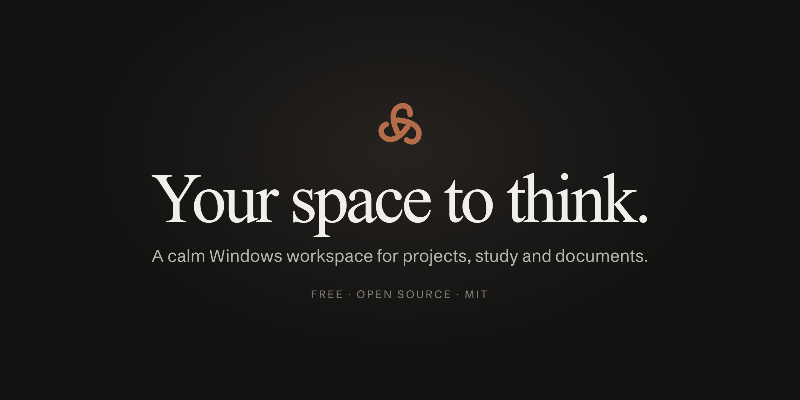
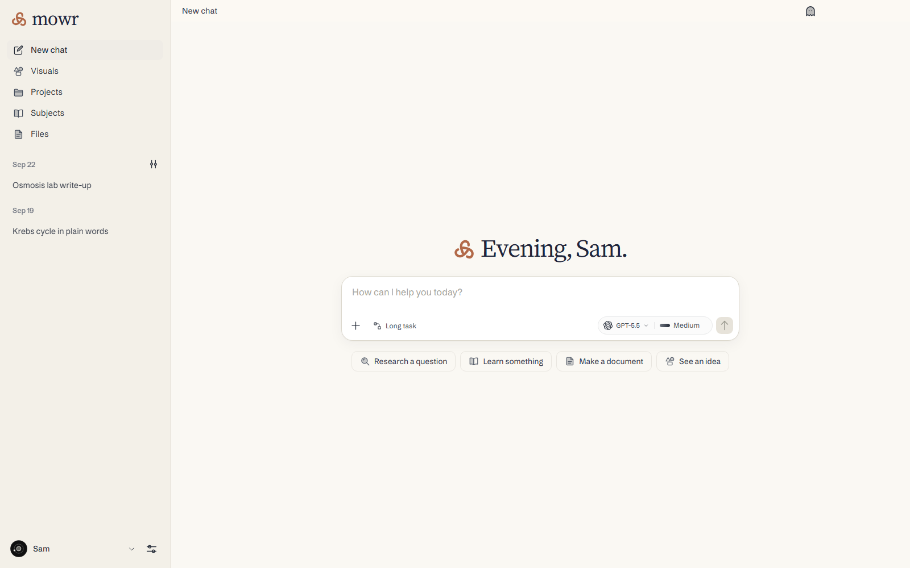
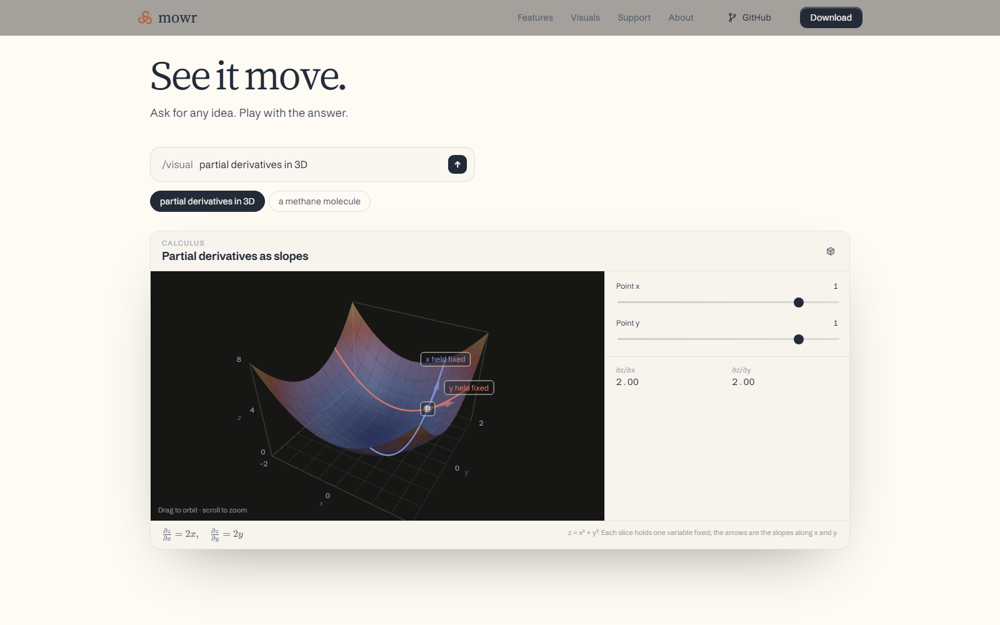
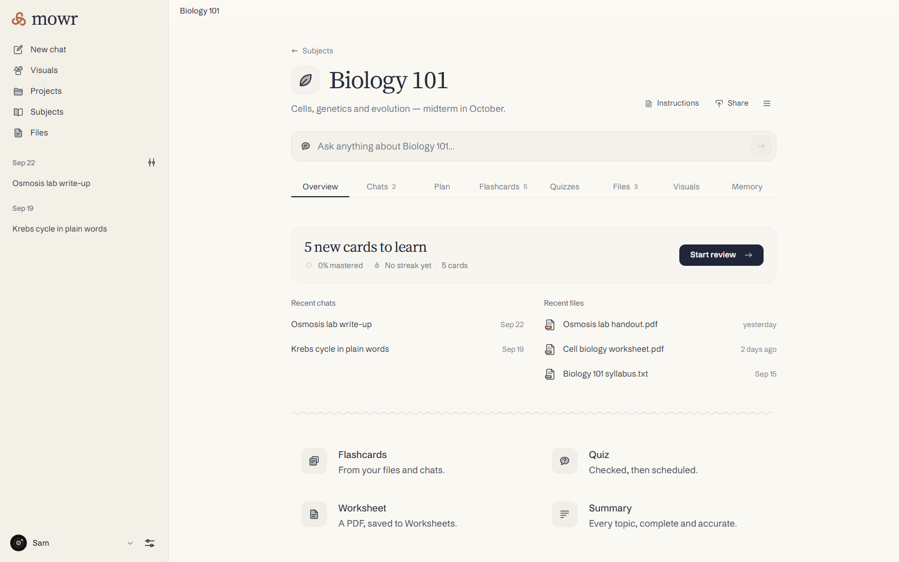
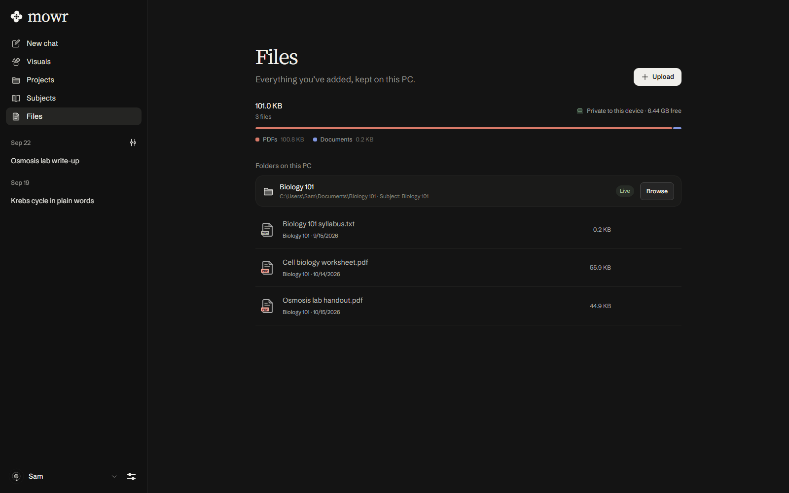
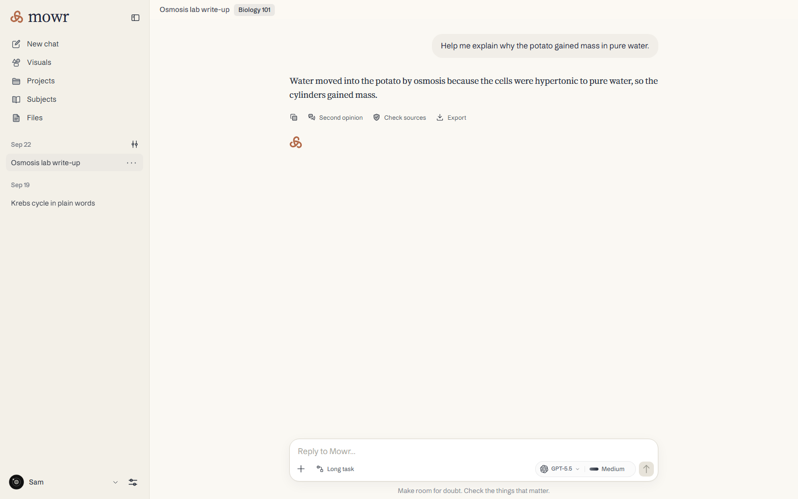
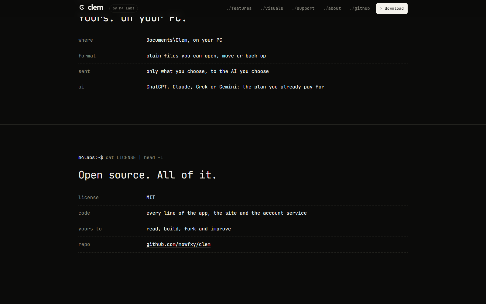
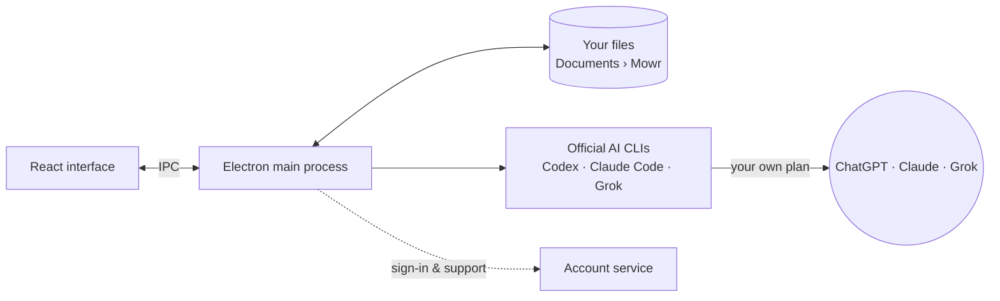

<p align="center">
  <a href="https://mowrai.com"></a>
</p>

<p align="center">
  <b>A calm, local-first Windows workspace for projects, study and documents,<br>powered by the AI plan you already have.</b>
</p>

<p align="center">
  <a href="https://mowrai.com/download/windows"></a>
</p>

<p align="center">
  <a href="LICENSE"></a>
  <a href="https://github.com/mowfxy/mowr-releases/releases"></a>
  <a href="https://github.com/mowfxy/mowr/actions/workflows/checks.yml"></a>
  
  <a href="CONTRIBUTING.md"></a>
</p>

<p align="center">
  <a href="https://mowrai.com">Website</a> ·
  <a href="https://mowrai.com/download/windows">Download</a> ·
  <a href="docs/FEATURES.md">Features</a> ·
  <a href="docs/ARCHITECTURE.md">Architecture</a> ·
  <a href="CONTRIBUTING.md">Contributing</a>
</p>

<br>

<p align="center">
  
</p>

## Why Mowr

Mowr is one quiet place for the work you bring to an AI: a course, a research question, a report, a pile of PDFs. Instead of another chat tab, you get **subjects and projects** that hold your files, chats, flashcards and drafts together, and an AI that answers from them.

- 🏠 **Yours, on your PC.** Everything lives in `Documents\Mowr` as plain files. No lock-in, no upload of your library.
- 🔌 **Bring your own AI.** Connect the ChatGPT, Claude or Grok plan you already pay for. Mowr adds no subscription.
- 🆓 **Free and open source.** No plan, no trial, no card. Every line is here under the [MIT License](LICENSE).

## What it does

<table>
  <tr>
    <td width="50%" valign="top">
      <h3>📚 Study that sticks</h3>
      <p>Subjects collect your notes and slides. Mowr makes flashcards, quizzes and worksheets from them and schedules every card with FSRS spaced repetition, paced to your exam date.</p>
    </td>
    <td width="50%" valign="top">
      <h3>📄 Real documents</h3>
      <p>Ask for a report, worksheet or summary and get a typeset PDF, or real Word, PowerPoint and Excel files. Tell it what to change and the same file changes, with Before/After and Undo.</p>
    </td>
  </tr>
  <tr>
    <td width="50%" valign="top">
      <h3>🔍 Answers you can check</h3>
      <p>Citations open your file at the right page. Calculations end with a check block that Mowr recomputes, and any answer can get a second opinion from another model.</p>
    </td>
    <td width="50%" valign="top">
      <h3>✨ Visuals for any idea</h3>
      <p>Type <code>/visual</code> and a topic. Get plots with sliders, 3D surfaces, step-through diagrams and charts you can play with, then export to PNG, SVG or PDF.</p>
    </td>
  </tr>
  <tr>
    <td width="50%" valign="top">
      <h3>📁 Your folders, live</h3>
      <p>Link folders on your PC or in Google Drive. Mowr reads them in place, notices when files on your PC change and proposes edits as diffs you approve.</p>
    </td>
    <td width="50%" valign="top">
      <h3>🧭 Long tasks</h3>
      <p>Hand over multi-step work. Chats run side by side, and Mowr can move to another connected account when one runs low on usage.</p>
    </td>
  </tr>
</table>

<p align="center">
  
</p>

<details>
<summary><b>More screenshots</b></summary>
<br>

| A subject | Your files |
| :---: | :---: |
|  |  |
| **A chat** | **Open source, on the website** |
|  |  |

<sub>Screenshots come from the built-in demo workspace with scripted replies. Re-shoot them with <code>node scripts/readme-screenshots.mjs</code>.</sub>
</details>

See **[Features in detail](docs/FEATURES.md)** for the full tour, with pointers into the code.

## Get Mowr

**[Download for Windows](https://mowrai.com/download/windows)** (Windows 10 and 11, 64-bit). Sign in, connect your AI in Settings → Models, and start a subject or a chat.

> [!NOTE]
> Mowr is a **preview**. Most of it is used daily, but some flows are still being verified. See [production status](docs/PRODUCTION-STATUS.md) for what's tested and what isn't.

## How it works



Each AI works as its own official CLI, inside a working folder built from your files, with its tools confined to that folder. Your chats and files stay on your PC; the account service only handles sign-in, support and your encrypted AI connections. More in [Architecture](docs/ARCHITECTURE.md).

## Build from source

You need **Windows 10/11**, **Node 25** and **npm**.

```powershell
git clone https://github.com/mowfxy/mowr.git
cd mowr
npm ci
copy .env.example .env.local    # set the Supabase public URL and key
npm run desktop:dev             # build and open the desktop app
```

| Command | What it does |
| --- | --- |
| `npm run desktop:dev` | Build and run the desktop app |
| `npm run dev` + `npm run server` | Run the website locally (two terminals) |
| `npm test` | Unit and integration tests |
| `npm run test:desktop` | Electron main-process tests |
| `npm run typecheck:server` | Type-check the server |
| `npm run verify:all` | Browser-driven checks in `scripts/verify/` |
| `npm run desktop:installer` | Build the Windows installer into `Installer/` |

Release, deploy and admin tasks are in [Maintaining Mowr](docs/MAINTAINING.md).

## Project layout

```text
desktop/      Electron main process: storage, sign-in, AI CLIs, folders, memory
src/          React interface (chat, spaces, files, visuals, settings)
src/site/     The marketing website at mowrai.com
core/         Shared workflows, built-in skills, spaced repetition, search
cloudflare/   Account and support Worker
vendor/       Kinetra: calculations, figures, PDF and Office tools
tests/        Unit, integration and desktop tests
scripts/      Builds, checks, screenshots and films
docs/         Architecture, features, data and operations
```

The full map is in [Architecture → Find the code](docs/ARCHITECTURE.md#find-the-code).

## Documentation

- [Features in detail](docs/FEATURES.md): every feature and where it lives
- [Architecture](docs/ARCHITECTURE.md): how the pieces fit
- [Desktop architecture and operations](docs/DESKTOP.md): security boundaries, storage and builds
- [Local data and subject transfers](docs/LOCAL-DATA.md): read before uninstalling or sharing an archive
- [Google Drive setup](docs/GOOGLE-SETUP.md)
- [Admin portal](docs/ADMIN.md)
- [Production status](docs/PRODUCTION-STATUS.md)

## Contributing

Bug reports, fixes and ideas are welcome. Read [CONTRIBUTING.md](CONTRIBUTING.md) to get set up, and open an issue before large changes. Report security problems privately as described in [SECURITY.md](SECURITY.md).

## Spread the word

Mowr is free and stays free. If it helps you, star this repo, share it, or send a fix. For help with the app, email [support@mowrai.com](mailto:support@mowrai.com).

## License

Mowr is released under the [MIT License](LICENSE). © 2026 Mohamed Mowafy.

Bundled components keep their own licenses: the Mowafy Sans and Mowafy Serif fonts are under the SIL Open Font License (`public/fonts/`), Kinetra is MIT (`vendor/kinetra/LICENSE`), and libheif is LGPL-3.0 (see [third-party notices](THIRD-PARTY-NOTICES.md)). The Mowr name and logo identify the official builds.
