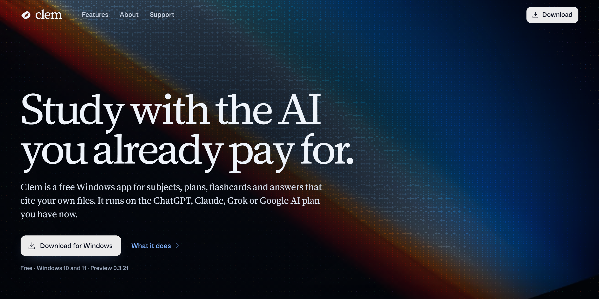
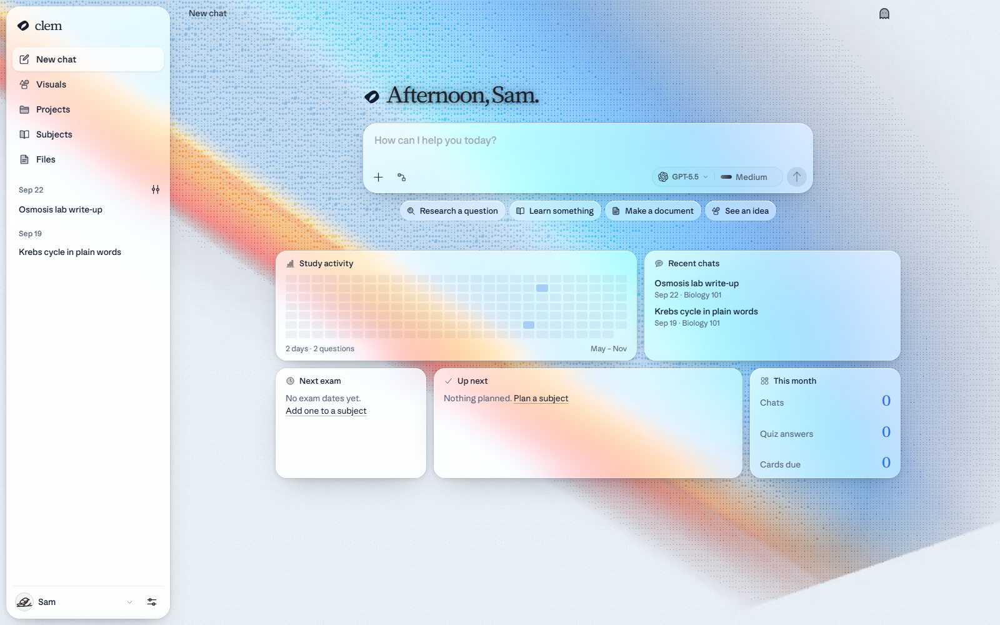
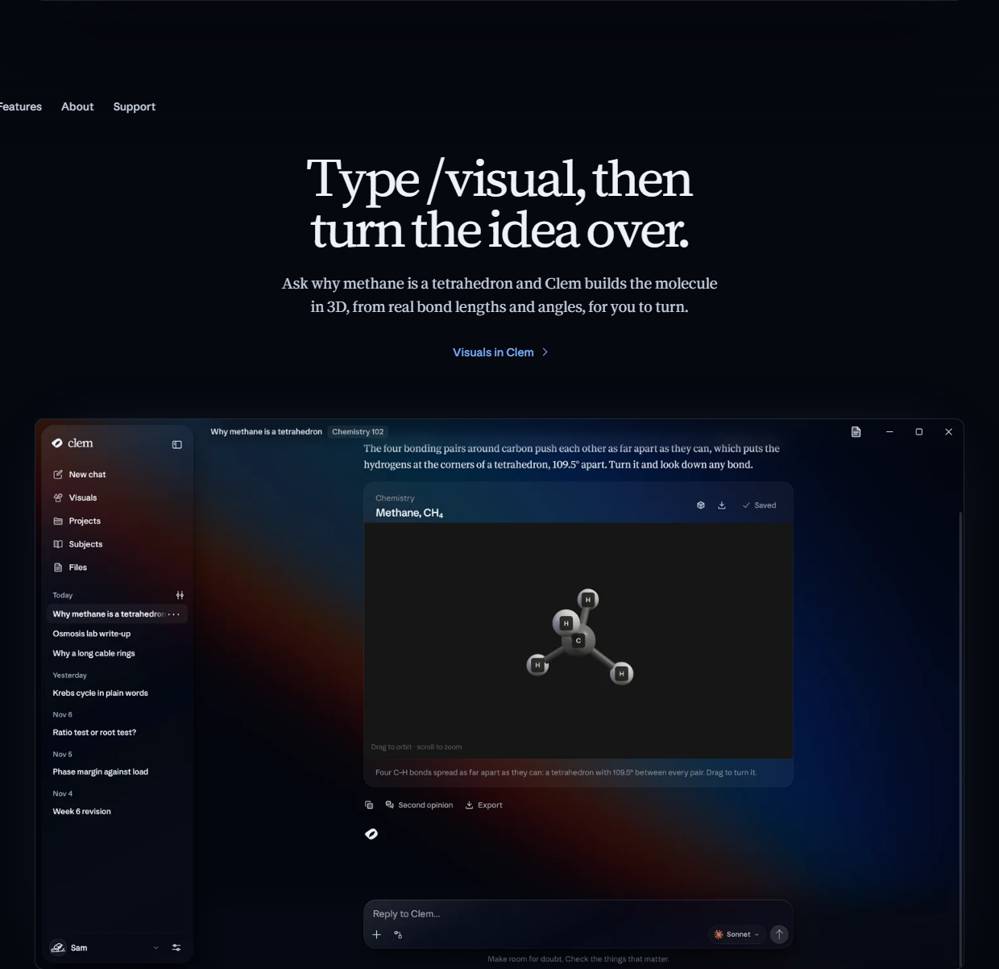
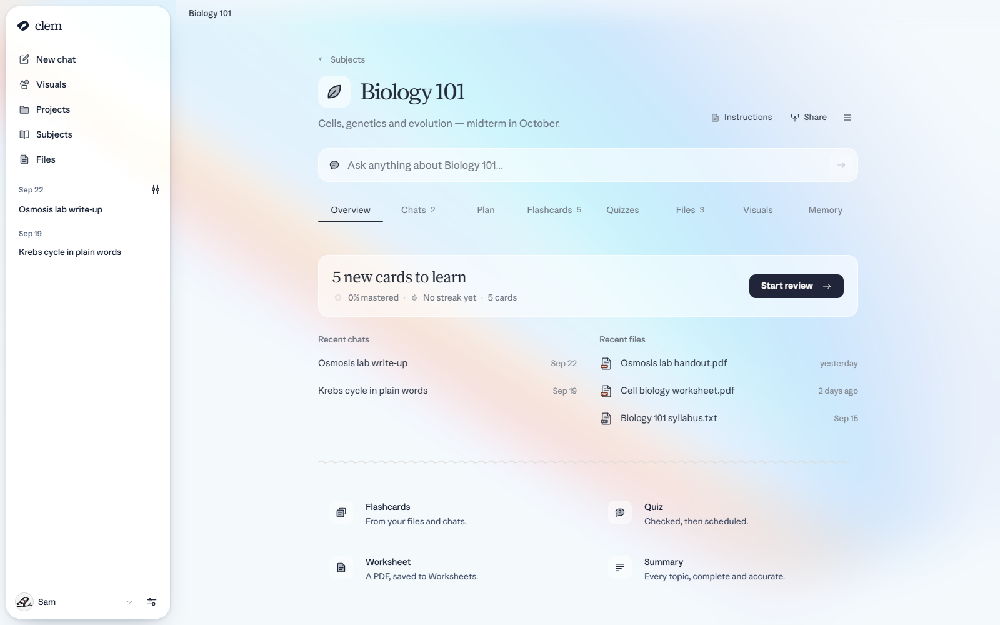
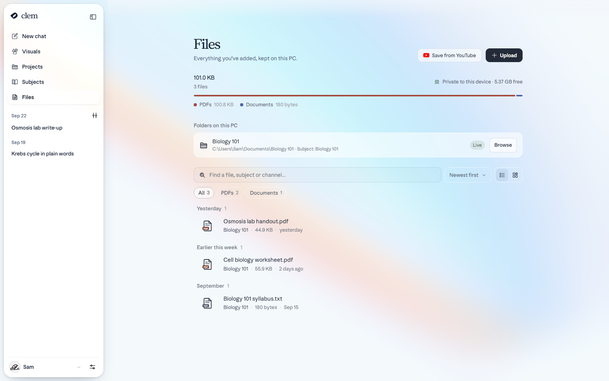
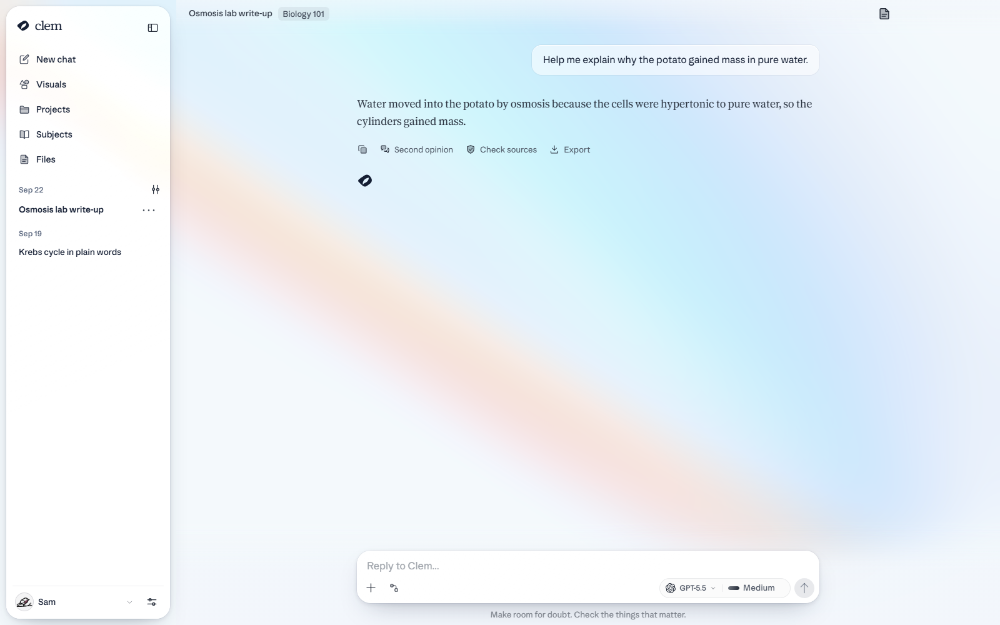
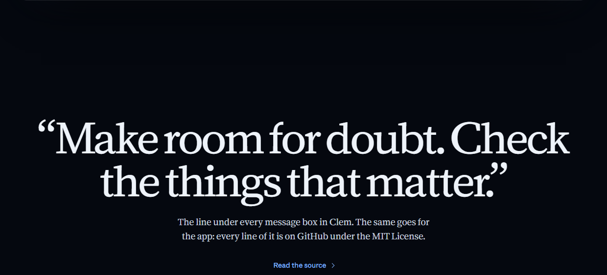
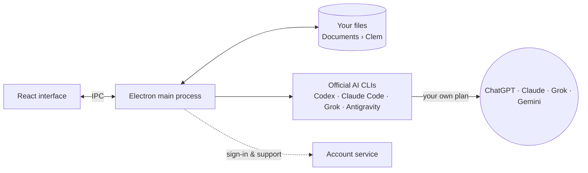

<p align="center">
  <a href="https://clem.m4labs.xyz"></a>
</p>

<p align="center">
  <b>A calm, local-first Windows workspace for projects, study and documents,<br>powered by the AI plan you already have.</b>
</p>

<p align="center">
  <a href="https://clem.m4labs.xyz/download/windows"></a>
</p>

<p align="center">
  <a href="LICENSE"></a>
  <a href="https://github.com/mowfxy/clem-releases/releases"></a>
  <a href="https://github.com/mowfxy/clem/actions/workflows/checks.yml"></a>
  
  <a href="CONTRIBUTING.md"></a>
</p>

<p align="center">
  <a href="https://clem.m4labs.xyz">Website</a> ·
  <a href="https://clem.m4labs.xyz/download/windows">Download</a> ·
  <a href="docs/FEATURES.md">Features</a> ·
  <a href="docs/ARCHITECTURE.md">Architecture</a> ·
  <a href="CONTRIBUTING.md">Contributing</a>
</p>

<br>

<p align="center">
  
</p>

## Why Clem

Clem is the first app from [M4 Labs](https://m4labs.xyz), an AI research lab that also builds apps.

Clem is one quiet place for the work you bring to an AI: a course, a research question, a report, a pile of PDFs. Instead of another chat tab, you get **subjects and projects** that hold your files, chats, flashcards and drafts together, and an AI that answers from them.

- 🏠 **Yours, on your PC.** Everything lives in `Documents\Clem` as plain files. No lock-in, no upload of your library.
- 🔌 **Bring your own AI.** Connect the ChatGPT, Claude, Grok or Google AI (Antigravity) plan you already pay for. Clem adds no subscription.
- 🆓 **Free and open source.** No plan, no trial, no card. Every line is here under the [MIT License](LICENSE).

## What it does

<table>
  <tr>
    <td width="50%" valign="top">
      <h3>📚 Study that sticks</h3>
      <p>Subjects collect your notes and slides. Clem makes flashcards, quizzes and worksheets from them and schedules every card with FSRS spaced repetition, paced to your exam date.</p>
    </td>
    <td width="50%" valign="top">
      <h3>📄 Real documents</h3>
      <p>Ask for a report, worksheet or summary and get a typeset PDF, or real Word, PowerPoint and Excel files. Tell it what to change and the same file changes, with Before/After and Undo.</p>
    </td>
  </tr>
  <tr>
    <td width="50%" valign="top">
      <h3>🔍 Answers you can check</h3>
      <p>Citations open your file at the right page. Calculations end with a check block that Clem recomputes, and any answer can get a second opinion from another model.</p>
    </td>
    <td width="50%" valign="top">
      <h3>✨ Visuals for any idea</h3>
      <p>Type <code>/visual</code> and a topic. Get plots with sliders, 3D surfaces, step-through diagrams and charts you can play with, then export to PNG, SVG or PDF.</p>
    </td>
  </tr>
  <tr>
    <td width="50%" valign="top">
      <h3>📁 Your folders, live</h3>
      <p>Link folders on your PC or in Google Drive. Clem reads them in place, notices when files on your PC change and proposes edits as diffs you approve.</p>
    </td>
    <td width="50%" valign="top">
      <h3>🧭 Long tasks</h3>
      <p>Hand over multi-step work. Chats run side by side, and Clem can move to another connected account when one runs low on usage.</p>
    </td>
  </tr>
</table>

<p align="center">
  
</p>

<details>
<summary><b>More screenshots</b></summary>
<br>

| A subject | Your files |
| :---: | :---: |
|  |  |
| **A chat** | **Open source, on the website** |
|  |  |

<sub>Screenshots come from the built-in demo workspace with scripted replies. Re-shoot them with <code>node scripts/readme-screenshots.mjs</code>.</sub>
</details>

See **[Features in detail](docs/FEATURES.md)** for the full tour, with pointers into the code.

## Get Clem

**[Download for Windows](https://clem.m4labs.xyz/download/windows)** (Windows 10 and 11, 64-bit). Sign in, connect your AI in Settings → Models, and start a subject or a chat.

> [!NOTE]
> Clem is a **preview**. Most of it is used daily, but some flows are still being verified. See [production status](docs/PRODUCTION-STATUS.md) for what's tested and what isn't.

## Set up the newer parts

### Home and the main thread

Clem opens on **home**. Tap its message box and it grows into the **main thread**: one long conversation with Clem's organizer, where the morning brief, reminders and anything Clem did on its own show up. Type freely there.

- **Hand-off.** A message that clearly belongs to one subject or project moves to that subject's latest chat, with a short note of what came before, and leaves a "Continued in Circuits" card behind. Type `@` to pick the subject yourself; the mention shows as a chip.
- **New chat in…** Under the box, home lists your recent subjects and projects; **Find** (`Ctrl J`) searches all of them.
- **The sidebar** holds subjects and projects only. Older chats that had no subject are untouched in **Settings → Data & privacy → Earlier chats**, each with **Move to…**.

More in [Main thread](docs/MAIN-THREAD.md).

### Proactivity and watches

**Settings → Proactivity** picks **Clem's organizer** (the model that runs the main thread), how chatty it is (quiet, balanced or proactive), quiet hours, which kinds of update reach you, and where (in Clem, as a Windows notification, on Telegram). Clem plans your day, turns new deadlines into tasks and moves overdue work, and every change it makes comes with **Undo**. Anything costly or outward-facing waits for one tap.

Ask in any chat for a **watch**, such as "tell me when the Circuits midterm room is posted". It shows as a card with **Stop**, and ends on its own after 60 days. **What Clem did today** in the same settings page lists everything.

### GUC (German University in Cairo)

1. **Sign in.** Settings → Connectors → GUC, with your GUC username and password. They stay in this PC's vault; Clem never sees them in the window.
2. **Link a course.** Create a subject while GUC is connected (or use **Create subject from this course** in the hub) and Clem opens a pinned **Setup** chat. It suggests the matching course ("This looks like CSEN 701, link it?"), then asks what to save and when to check.
3. **Say it your way.** Answer in your own words: "only slides and sheets under 50 MB", "everything except videos", "only week 3 onwards" for what to save; "after each lecture", "every 2 hours on weekdays 8am–10pm", "hourly during exams" for check times. Times are Cairo time, and never more often than every 30 minutes. You can change either later in the subject's chat, on its CMS tab, or in Settings → Connectors → GUC.
4. **Checks.** Each check reads the course page only when it changed and downloads only new files your rules keep. Saved files land in the subject's Files, and its Setup chat gets a card for them and for news (announcements, grades, deadlines).
5. **Password changes.** When GUC asks you for a new password, Clem pauses every check (nothing is deleted), tells you once in the main thread, and shows a banner in the hub. **Update password** opens the field in Settings → Connectors → GUC; saving it resumes checks and catches up.

The **GUC hub** (GUC in the sidebar while connected) has your schedule, announcements, CMS files by course and week, grades and deadlines, with search across courses. It draws its last copy at once and refreshes behind it.

**Drive copy.** Turn on the subject's Drive card to copy its saved files to `Clem/GUC/<course>/<week>` in your Google Drive (or a folder you pick). A file is sent once; if Drive is disconnected, files wait for **Reconnect Drive**.

How it all works: [GUC, VPS and Telegram engine](docs/GUC-VPS-ENGINE.md).

### Telegram

Say "connect my Telegram" in the main thread, or use **Settings → Channels → Telegram → Pair in chat**. A card shows a link and a 6-digit code (good for 10 minutes); open the link or send the code to the Clem bot, and the card turns into **Connected as @you**. Then you can talk to Clem there, tap buttons on its cards, and ask for files ("send me lecture 3 slides"). Choose which updates go to Telegram in Settings → Proactivity. **Unpair** is on the card and in Settings.

Running your own copy? The bot's one-time setup is in [Deploying Telegram](docs/DESKTOP.md#deploying-telegram-owner).

### Your own server (VPS)

A VPS keeps Clem's files and background work always on, with this PC as the window and a cache.

1. **Key.** Settings → Connectors → VPS: enter the server and user, then **Generate a key for me** (or paste your own and **Use this key**). Run the one-line command it shows on the server to add the key, then **Save and test**. The first connection remembers the server's fingerprint; a change later stops and asks. Password sign-in is off unless you turn it on under Advanced.
2. **Storage.** Choose where files live. **Move everything** copies files to the VPS one at a time, checking each against its checksum before the PC copy becomes cache; **Move back** reverses it, and **Stop** is safe at any point. Set the cache limit and pin files you want kept on this PC.
3. **Background jobs.** Turn on **Run Clem's background jobs on my VPS** to install the worker (Docker with Postgres when available, otherwise a systemd service with Node 22+). Only one copy of Clem runs jobs at a time; this PC takes over if the server goes quiet for 10 minutes.
4. **What is sent.** Settings lists it: your GUC sign-in, a Telegram relay token that only reaches Telegram, a model API key only if you type one for the worker, and the worker's own access token. They are sealed with a key kept on the server. Without a model, the worker organizes by rules and leaves the rest to this PC.

### AI tools

Every chat's AI can use these, through the same tool every model gets:

- **GUC:** `guc.schedule`, `guc.deadlines`, `guc.announcements`, `guc.materials`, `guc.read` (any CMS file's text, saved or not), `guc.grades`, `guc.search`, `guc.settings` (changes save rules or check times from your words) and `guc.help`. Only while GUC is connected, and only for your own account.
- **Organizer:** `clem.watch` and `clem.unwatch`.
- **Telegram:** `telegram.pair` and `telegram.sendFile`.
- **VPS:** `vps.service_status`, `vps.read_file`, `vps.write_file` and `vps.run_command`. Read-only commands run at once; anything that could change the server shows a card and waits for **Run it**.

## How it works



Each AI works as its own official CLI, inside a working folder built from your files, with its tools confined to that folder. Your chats and files stay on your PC; the account service only handles sign-in, support and your encrypted AI connections. More in [Architecture](docs/ARCHITECTURE.md).

## Build from source

You need **Windows 10/11**, **Node 25** and **npm**.

```powershell
git clone https://github.com/mowfxy/clem.git
cd clem
npm ci
copy .env.example .env.local    # set the Supabase public URL and key
npm run desktop:dev             # build and open the desktop app
```

| Command | What it does |
| --- | --- |
| `npm run desktop:dev` | Build and run the desktop app |
| `npm run dev` + `npm run server` | Run the website locally (two terminals) |
| `npm test` | Unit and integration tests |
| `npm run test:desktop` | Electron main-process tests |
| `npm run typecheck:server` | Type-check the server |
| `npm run verify:all` | Browser-driven checks in `scripts/verify/` (one alone: `node scripts/verify/guc-hub.mjs`) |
| `node scripts/verify/perf.mjs` | Times home, the main thread, the GUC hub and settings against their budgets |
| `node scripts/bench-guc-engine.ts` | Measures GUC syncs and checks on a large fake CMS |
| `npm run worker:build` | Build the VPS worker into `worker-dist/` |
| `npm run desktop:installer` | Build the Windows installer into `Installer/` |

The GUC, Telegram and VPS tests run against fakes (`tests/guc-fake.ts`, `tests/telegram-fake.ts`, `tests/vps-fake.ts`), so `npm test` needs no account or server.

Release, deploy and admin tasks are in [Maintaining Clem](docs/MAINTAINING.md).

## Project layout

```text
desktop/      Electron main process: storage, sign-in, AI CLIs, folders, memory; engine/ runs GUC, the organizer, Telegram and the VPS
src/          React interface (chat, spaces, files, visuals, settings)
src/site/     The website at clem.m4labs.xyz (site.css; app captures in public/shots from scripts/site/capture.mjs)
core/         Shared workflows, built-in skills, spaced repetition, search
cloudflare/   Account and support Worker, and the Telegram bot
worker/       Clem's engine, headless on a VPS (Docker or systemd)
vendor/       Kinetra: calculations, figures, PDF and Office tools
tests/        Unit, integration and desktop tests
scripts/      Builds, checks, screenshots and films
docs/         Architecture, features, data and operations
```

The full map is in [Architecture → Find the code](docs/ARCHITECTURE.md#find-the-code).

## Documentation

- [Features in detail](docs/FEATURES.md): every feature and where it lives
- [Architecture](docs/ARCHITECTURE.md): how the pieces fit
- [Desktop architecture and operations](docs/DESKTOP.md): security boundaries, storage and builds, Telegram
- [Main thread](docs/MAIN-THREAD.md): home, the main thread, hand-off and proactivity
- [GUC, VPS and Telegram engine](docs/GUC-VPS-ENGINE.md): sync, checks, the hub, AI tools and the VPS worker
- [Performance: GUC, main thread and VPS](docs/PERFORMANCE-GUC-VPS.md): measured numbers and budgets
- [Local data and subject transfers](docs/LOCAL-DATA.md): read before uninstalling or sharing an archive
- [Google Drive setup](docs/GOOGLE-SETUP.md)
- [Admin portal](docs/ADMIN.md)
- [Production status](docs/PRODUCTION-STATUS.md)

## Contributing

Bug reports, fixes and ideas are welcome. Read [CONTRIBUTING.md](CONTRIBUTING.md) to get set up, and open an issue before large changes. Report security problems privately as described in [SECURITY.md](SECURITY.md).

## Spread the word

Clem is free and stays free. If it helps you, star this repo, share it, or send a fix. For help with the app, email [support@m4labs.xyz](mailto:support@m4labs.xyz).

## License

Clem is released under the [MIT License](LICENSE). © 2026 Mohamed Mowafy.

Bundled components keep their own licenses: the Mowafy Sans and Mowafy Serif fonts are under the SIL Open Font License (`public/fonts/`), Kinetra is MIT (`vendor/kinetra/LICENSE`), libheif is LGPL-3.0, and the way Clem reads the GUC CMS follows cms-downloader (MIT); see [third-party notices](THIRD-PARTY-NOTICES.md). The Clem name and logo identify the official builds.
