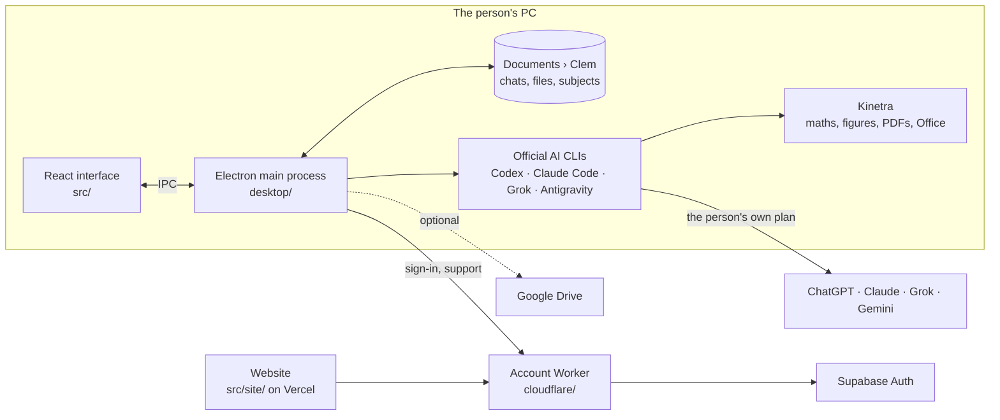

# Architecture

Clem is an Electron app. The React interface runs in the window; everything that touches files, credentials or AI runs in the main process on the person's PC. A small cloud account service handles sign-in and support, and never sees chats or files.

Each AI answers as its own CLI inside a working folder made from the person's files, with its tools confined to that folder. See [Features in detail](FEATURES.md) for how each one is sandboxed, and [Desktop architecture and operations](DESKTOP.md) for security boundaries, storage and builds.

## Find the code

- `desktop/`: main process, protected storage, authentication, local Codex and Claude, folders and memory. `provider-link.ts` backs connections up to the account and restores them after a reinstall.
- `src/App.tsx`: the workspace shell. Features live in their own folders: `src/notices/` (notice stack, handoff, account signals), `src/support/` (in-app support inbox), `src/command/` (command palette), `src/desktop/` (onboarding and desktop controls).
- `src/files/`: the file panel beside chats and the popup viewer (`FilePanel.tsx`), change-request routing (`intent.ts`), saved-file search and renaming. `src/chat/Links.tsx` draws link chips and in-place YouTube players.
- `src/space/`: subject and project pages. `src/drive/`: Google Drive, live — under `drive.file` only: Google's own picker (opened in the browser through the OAuth flow with `trigger_onepick`) grants the files and folders Clem may open; Clem's panel browses and searches those and the files it made, with thumbnails, a linked folder read live in a space, file text read in memory for questions. `desktop/drive-live.ts` talks to Google and streams video through a private 127.0.0.1 server so long videos start and seek. Nothing from Drive is copied to the PC; `drive-sync.ts` only saves Clem-made files back to a linked folder.
- `src/visuals/`: the visuals engine. `scenes.ts` holds the models; `pen.ts` draws each one to canvas (live) or SVG (exports, thumbnails).
- `src/site/`: the marketing website (landing, features, pricing, download, legal). Sign-in, inbox and email-link pages are in `src/Login.tsx`.
- `emails/`: generated by `npm run emails`; animated artwork in `public/email/` comes from `npm run emails:art`. Apply auth templates with `npm run emails:apply` (templates only; needs SUPABASE_ACCESS_TOKEN). `src/admin/`: the admin portal.
- `cloudflare/account-worker.js`: account/entitlement Worker entry. Route modules: `admin.js`, `support.js`, `provider-vault.js` (ChatGPT and Claude connections kept with the account, encrypted); shared helpers in `cloudflare/lib/` (`pack.js` compresses stored payloads). Schemas: `account-schema.sql`, `sync-schema.sql`, `admin-schema.sql`, `provider-links.sql`.
- `core/`, `vendor/kinetra/`: shared workflows and bundled Kinetra guides, calculations and document illustrations. `desktop/kinetra-diagrams.ts` adds flowcharts, charts, timelines, cycles, mind maps, trees and Venn diagrams for PDFs; every recipe is rendered by the real worker in the tests. Kinetra runs for Codex, Claude and Grok alike.
- `server/`, `database/`: legacy web services and migrations retained during migration.
- `tests/`, `tests/desktop/`: unit and integration tests; `scripts/verify/*.mjs`: browser-driven checks.
